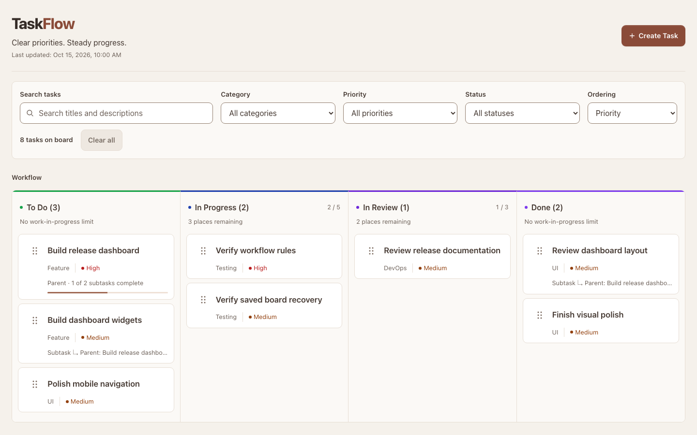
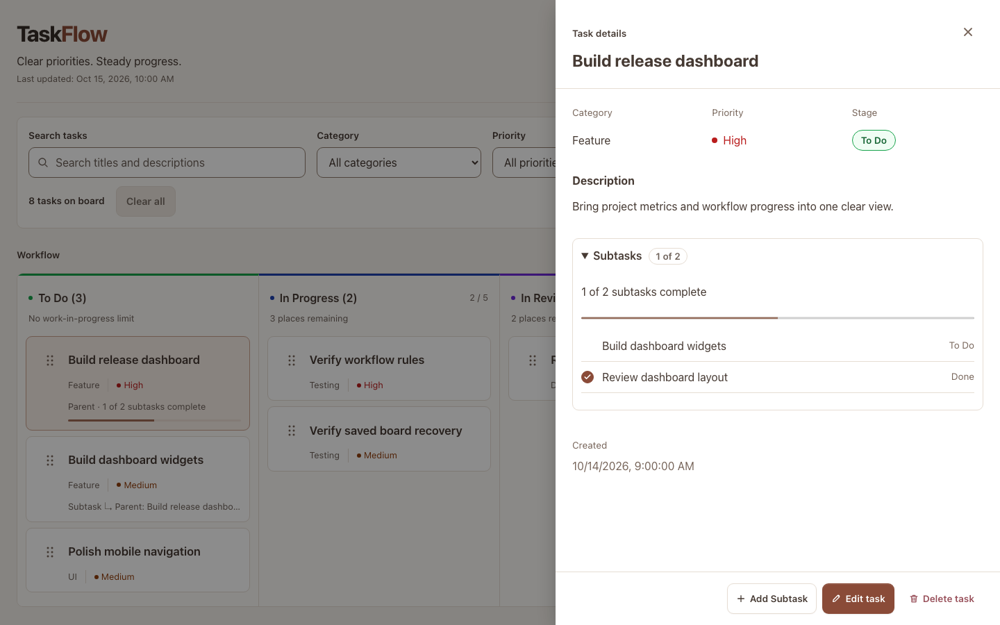
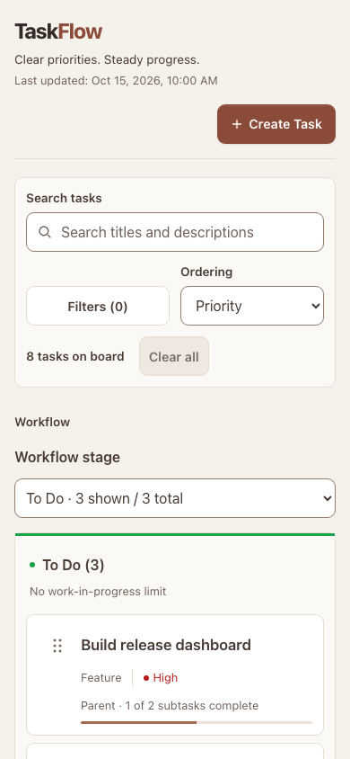

# TaskFlow


[](https://vitest.dev/)
[](https://playwright.dev/)

**Clear priorities. Steady progress.** TaskFlow is a browser-based workflow board
built with React, strict TypeScript, Vite and dnd-kit. It brings together a
responsive Kanban interface, explicit workflow rules and validated local
persistence in a frontend engineering project.

**TaskFlow v2.0.0 is released.** Try the
[production demo](https://taskflow-garrib10.vercel.app/) or read the
[published release notes](https://github.com/garrib10/taskflow/releases/tag/v2.0.0).
Production follows `main`; subsequent updates are reviewed and tested through
`develop → staging → main`.

## The v2 modernization

v2 develops the original task board into a more complete frontend application:
a warm clay visual system and shared controls, a responsive application shell,
compact cards, read-first task details, clearer forms and focused board controls.
The engineering work separates durable domain data, view preferences and
interactions, adds independent manual ordering and capacity policy, and upgrades
the persistence boundary while preserving supported v1.x data.



| Task details and related work | Mobile board |
| --- | --- |
| [](screenshots/v2/desktop-details.png) | [](screenshots/v2/mobile-board.png) |

[All current screenshots](screenshots/v2/README.md) ·
[Short workflow videos](docs/v2-performance-regression.md#workflow-videos) ·
[Before/after and portfolio materials](docs/portfolio.md)

## Capabilities and rules

- **Four stages:** To Do → In Progress → In Review → Done. Cross-stage moves
  advance one stage; skipping, reversing and reopening Done are rejected.
- **Capacity:** In Progress allows five tasks and In Review three. To Do and Done
  are unlimited. Counts include filtered-out tasks and linked subtasks. Existing
  over-limit saved boards remain readable; further arrivals are blocked until
  space is available.
- **Movement:** pointer drag, touch hold-and-drag, keyboard movement and a validated
  Stage selector in the editor share the same domain rules. Cards show valid and
  rejected drop feedback; movement retains meaningful keyboard focus.
- **Ordering:** Priority sorts High → Medium → Low with stable per-stage arrival
  ties. Manual retains a separate ID order without changing priorities or ties.
  Unfiltered Manual supports drop placement and named Move earlier/later actions;
  clear search and filters before reordering within a stage.
- **Tasks and related work:** create, edit and confirm deletion; one level of linked
  parent/child tasks with independent stages, parent navigation, progress and
  collapsible subtasks. A parent cannot finish until every child is Done.
  Confirmed parent deletion detaches and preserves its children.
- **Details and drafts:** task titles open a desktop drawer or mobile sheet.
  Category, Priority and Stage appear consistently. Content saves explicitly;
  Stage and relationship changes save separately. Closing a dirty draft asks
  whether to keep editing or discard it.
- **Search and filters:** case-insensitive title/description search combines with
  Category, Priority and Status. Active chips, result counts, zero-result recovery
  and clear-all keep scope visible. Filtering never changes the saved board.
- **Feedback:** typed success, information, warning and error notices distinguish
  transient outcomes from persistent saving/recovery restrictions.
- **Responsive access:** mobile shows one selected stage; tablet retains an
  intentional horizontal board scroller. Dialogs scroll and footer actions wrap
  on narrow/short screens. Named controls, associated errors, visible focus,
  modal isolation/focus return, live announcements and reduced motion are tested.

Full WCAG certification, physical-device behavior and spoken screen-reader output
are not established by automated checks. See the [accessibility audit](docs/v2-accessibility.md).

## Run locally

Use **Node.js 24.15 or newer in the Node 24 line**. CI uses Node 24.

```bash
git clone https://github.com/garrib10/taskflow.git
cd taskflow
npm ci
npm run dev
```

Vite prints the development URL. To build and serve production assets locally:

```bash
npm run build
npm run preview
```

Saved data belongs to the exact origin: scheme, host and port, plus browser/profile.
Changing ports or moving between preview, staging and production does not transfer
boards. There is no cloud synchronization.

## Architecture

| Layer | Responsibility |
| --- | --- |
| `components/`, `styles/`, `accessibility/` | Shell, board, cards, details/forms, shared controls, semantic tokens, focus and input behavior |
| `domain/task/`, `domain/board/` | Typed models, content/workflow/capacity/relationship rules, atomic reducer actions, ordering and pure selectors |
| `hooks/` | Reducer/session integration, transient board criteria and independent ordering preference |
| `persistence/`, `utils/storage.ts` | Unknown-data validation, trusted projections, versioned DTOs, migration, recovery and storage access |
| `notifications/` | Typed feedback and notice lifecycle |
| `test/`, `e2e/` | Deterministic fixtures, domain/component/application tests and real-browser journeys |

UI preflight reports failures; the reducer validates again against the complete
current board before returning an immutable next state. Rejected operations retain
board identity and timestamps. Derived progress, counts and filtered/sorted views
are computed from source data. IDs and timestamps enter through actions; storage
is coordinated outside the reducer.

The [architecture and state guide](docs/v2-state-ownership.md) explains ownership,
TypeScript choices, selectors, atomicity and the save boundary. Detailed guides:
[ordering](docs/v2-manual-ordering.md), [capacity](docs/v2-column-capacity.md),
[board controls](docs/v2-board-controls.md), [details/forms](docs/v2-task-details.md),
[design tokens](docs/v2-design-tokens.md) and [shared primitives](docs/v2-interface-primitives.md).

## Persistence and upgrading v1.x data

Application version **2.0.0** is independent of board schema **3**. The
`taskflow-board` key holds `{ schemaVersion, revision, board }`; dates serialize as
canonical ISO strings. Column arrival arrays and nullable manual ID lists remain
separate. The independent `taskflow-view-preferences` key stores schema **1** and
only the selected Priority/Manual mode. Search, filters, drafts, dialogs,
notifications and drag/focus state are not persisted.

Supported upgrades are unversioned v0 → v1 → v2 → v3, schema 1 → v2 → v3, and
v1.5/schema 2 → v3. Validation precedes full-result writeback. Legacy checklist
conversion preserves IDs, titles and completion in linked tasks; schema-2-to-3
preserves valid tasks, links, dates, arrival ties and existing manual lists.
Repeated loads do not duplicate children or reinitialize positions. Valid current
schema-3 data hydrates without a mount-time rewrite.

Only a genuinely missing board initializes starter data. Invalid JSON/core data,
failed migrations and future versions retain the original saved bytes and pause
saving. Damaged order restores safe core data in Priority until confirmed repair.
Read restrictions, failed writes and external-tab changes expose explicit retry
or reload actions. Confirmed replacement is destructive and clearly labeled.
Closing a notice does not resume saving.

No separate migration backup is created. A failure before writeback preserves the
original; a postflight failure can follow a complete write, so persistence remains
unconfirmed rather than promising rollback. LocalStorage has no transactional
compare-and-swap, and tabs do not merge automatically. Keep a tab open after a save
failure until retry or deliberate recovery. Older releases may not read schema 3;
there is no automatic downgrade migration.

[Schema contract](docs/v2-persistence-schema.md) ·
[Migration paths](docs/v2-data-migration.md) ·
[Recovery behavior](docs/v2-persistence-recovery.md) ·
[Independent preferences](docs/v2-view-preferences.md)

## Testing and quality

```bash
npm run lint
npm run typecheck
npm test
npm run build
npx playwright install chromium
CI=1 npm run test:e2e:ci
```

Vitest covers domain, persistence, components and full-App integration. Playwright
runs desktop/mobile Chromium against the production build under `CI=1`; it starts
a preview at `127.0.0.1:4173`. Keep `dist` unchanged during a browser run.
`npm run test:watch` watches unit tests; `npm run test:e2e:report` opens the browser
report. CI installs Chromium with system dependencies and retains failed-test
traces/screenshots plus Vitest JUnit output.

For a specific preview, run
`PLAYWRIGHT_BASE_URL=https://your-preview.vercel.app npm run test:e2e`.
Protected previews require normal owner access. Tests neither store credentials
nor bypass deployment protection.

The merged [#49 QA record](docs/v2-performance-regression.md) reports:

- **487 Vitest tests / 45 files**, **70 Chromium cases**, **60 selected Firefox/WebKit
  cases**, and nine focused recovery repetitions, without browser retries.
- Seventeen practical regression checks, eleven viewport configurations, keyboard/
  focus/announcement checks, axe scans, reduced motion and actual 100/200/400% zoom.
- Production JS **327.18KB / 99.73KB gzip**, CSS **48.93KB / 8.36KB gzip**, with no
  build warnings. Lighthouse mobile medians **99/100/96/82** and desktop
  **100/100/96/82** for Performance/Accessibility/Best Practices/SEO.
- 20/100/300-task workload measurements on an **off-reference Intel Mac**, including
  a 151.9ms median large-desktop reset. These are observations against #97 targets,
  not M1 reference-host certification or field performance guarantees.

The [testing strategy](docs/v2-testing.md) maps requirements to existing tests;
the [release checklist](docs/v2-release-checklist.md) distinguishes branch checks
from still-pending staging and production verification. No numerical test-coverage
percentage or full accessibility certification is claimed.

## Keyboard operation

Tab to a task's movement button. **Space/Enter** picks up, **Left/Right** chooses a
stage, **Space/Enter** drops, and **Escape/Tab** cancels. The visible instructions
and live region explain destinations and rejected moves. Open the title to review
details, then choose Edit task. Dialogs contain focus and restore a meaningful
control when closed. macOS WebKit may require **Option-Tab** to include buttons,
depending on native keyboard-navigation behavior.

## Deployment and release

```text
release branch → develop → staging → main
```

Vercel Git integration builds with `npm run build`. Working branches, `develop`
and `staging` use normal Preview deployments; `main` is production. No paid custom
pre-production environment is required. Frontend CI, Dependency Review and CodeQL
provide repository checks; successful deployment status alone does not prove the
app works in the browser.

The preparation PR references #50 and requires owner review. Promote through
staging, test supported legacy fixtures on that exact origin, then promote to
main. Verify the production commit, deployed app and preserved workflows before
creating the annotated `v2.0.0` tag and GitHub release. The preparation branch does
not perform these steps. See the [branch workflow](docs/branching-workflow.md) and
[precise remaining checklist](docs/v2-release-checklist.md).

## Scope and history

TaskFlow is a single-user, frontend-only application backed by browser LocalStorage.
It includes no backend/database server, authentication, teams, collaboration,
SaaS accounts, AI task generation/prioritization, due dates, import/export or
cross-device synchronization. Capacity is fixed policy; there is no capacity
settings screen. Physical-device, actual Safari and spoken VoiceOver checks,
deployed analytics/routing and search metadata remain documented release-review
limits. Browser storage can be cleared, restricted or exhausted.

- **v1.0–v1.2:** original board, CRUD, priorities/categories, checklists, search and
  filters. These releases and their imagery are historical.
- **v1.5.0:** linked work, strict domain handling, persistence reliability,
  notifications, component styling, accessibility and CI foundations.
- **v2.0.0 preparation:** visual/shell/board/details modernization, explicit state
  boundaries, Manual ordering, capacity rules, schema-3 migration/recovery,
  independent preferences and expanded validation. [Release notes](docs/releases/v2.0.0.md).
