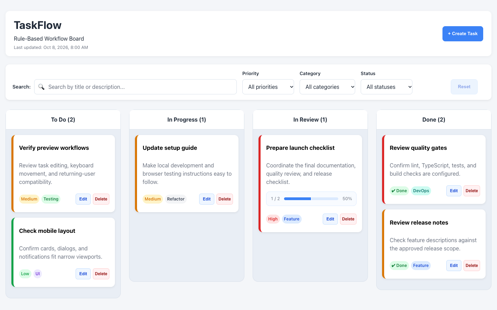

# TaskFlow portfolio materials — v2.0 preparation

Copy-ready material for the owner's external portfolio. No external website has
been edited. Until staging/main promotion and production verification finish,
label v2 as a release candidate; the live production demo may still show v1.5.

## Short description

TaskFlow is a React and TypeScript workflow board with a responsive Kanban
interface, keyboard task movement, linked subtasks and validated browser storage.
Its v2 modernization combines a warm visual system with explicit domain rules,
safe legacy-data migration and automated regression coverage.

## Project case study

I modernized a working task board into a more structured frontend application
while preserving supported existing data. React components handle interaction,
pure TypeScript rules and atomic reducer operations protect the complete board,
and a typed persistence boundary validates, migrates and recovers LocalStorage
snapshots. Priority and Manual ordering remain independent, and capacity and
parent-completion guards apply even when filtering hides affected tasks.

The interface uses semantic design tokens, shared controls, desktop task drawers,
mobile sheets and consistent focus/feedback behavior. Validation combines domain,
component and application tests with real-browser workflow, migration, recovery,
keyboard and responsive checks. Technical QA includes bundle inspection,
Lighthouse and representative board measurements, with hardware/device limits
recorded rather than hidden behind a single score.

## Evidence to feature

- React, strict TypeScript, Vite, dnd-kit; explicit UI/domain/persistence boundaries.
- 487 unit/component/integration tests and 70 Chromium browser executions in the
  #49 baseline; selected Firefox/WebKit and actual browser-zoom checks separately.
- Lighthouse median Performance 99 mobile/100 desktop and Accessibility 100 in
  sampled local audits; not a claim of full accessibility or field performance.
- [Architecture](v2-state-ownership.md), [testing strategy](v2-testing.md),
  [technical QA](v2-performance-regression.md) and [release notes](releases/v2.0.0.md).

## Visual modernization

Historical v1.5 imagery is retained as evidence, not labeled as the current UI.
The before and after use the same desktop **1440×900** viewport with different
representative sample boards; they demonstrate the interface, not a benchmark.

| Before — v1.5 | After — v2.0 candidate |
| --- | --- |
|  |  |

Use [the screenshot guide](../screenshots/v2/README.md) for consistent viewport,
fixture and capture details, including parent details, editing, filters and mobile.
The [short workflow recordings](v2-performance-regression.md#workflow-videos) show
keyboard movement, saving through refresh and mobile filtering. A polished release
walkthrough can be prepared from the verified production build later.

## Boundaries to keep in portfolio claims

This is a single-user frontend project using origin-local browser storage. It
has no backend/database server, authentication, teams, collaboration, SaaS billing,
AI-generated work or cloud sync. Do not describe pending staging/production/tag/
release checks as completed. Record the final live demo and GitHub release URLs
only after the owner verifies publication.
