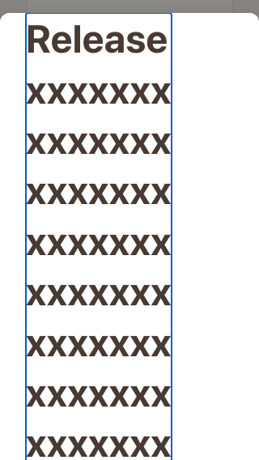
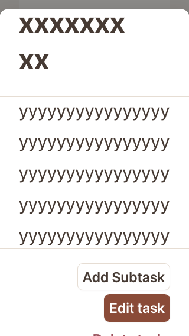
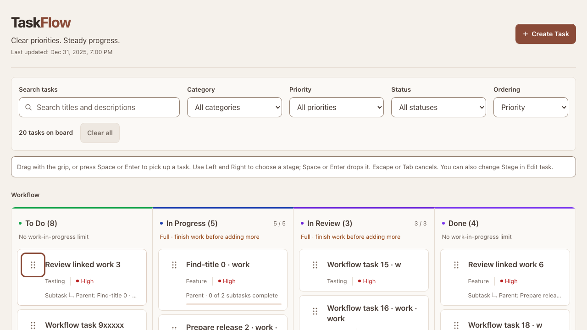
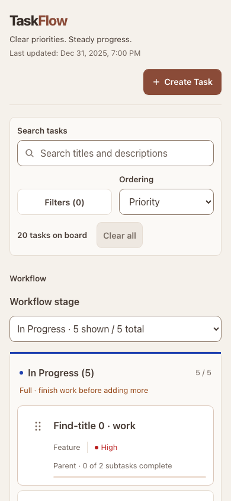
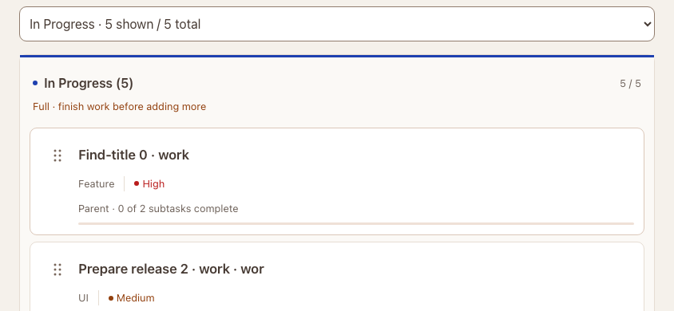
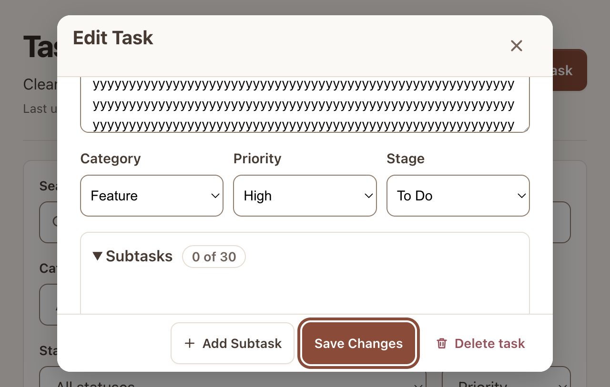
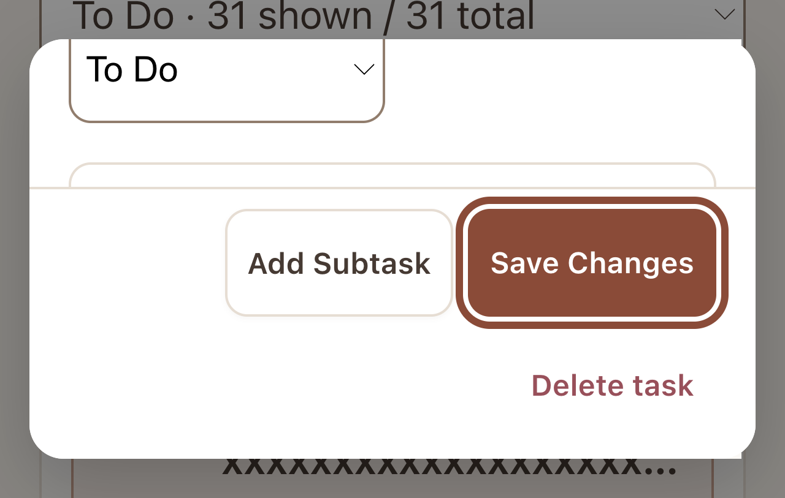

# Responsive and accessible interactions (#47)

Baseline: `140d214`, merged #44–#46. This is an interaction/refinement pass; domain rules, saved data and the warm clay identity remain unchanged.

## Baseline audit, before product changes

| Severity | Demonstrated finding | Implemented correction |
| --- | --- | --- |
| High | Keyboard pickup puts `aria-pressed=true` on a `group`; axe reports `aria-allowed-attr` critical. The grip is not exposed as an action button. | Use a native movement button with the same dnd-kit listeners/domain operation. |
| High | At 320px/200% text, editor footer exceeds its width (303px content in 296px). Three selects shrink to 68–97px at 25.6px text. | Let actions wrap and fields reflow without reducing text. |
| High | Long-title details at 320px/200% text and short heights leave only padding in the body (64px client height, 32px top/bottom padding); inner information cannot be read normally. | Guarantee a readable content area and allow the surrounding panel/form to scroll when needed. |
| Medium | A touch phone rotated to 844×390 uses four desktop columns instead of the approved single stage. | Reuse the narrow-board presentation for coarse-pointer short viewports, keeping desktop scrollers intact. |
| Medium | Movement instructions are screen-reader-only, outside landmarks; axe flags `region`. Sighted keyboard users do not see the keys on grip focus. | Put one instruction inside main and reveal it on keyboard movement focus. |
| Medium | Drag-source opacity reduces text contrast to 1.80–2.15:1 during pickup. | Preserve source text contrast and use existing dashed/background cues instead of whole-card opacity. |
| Medium | Native input boundaries are 2.84:1 against white; editor override is only 1.34:1. | Adjust the neutral control-border role and remove the faint editor override; retain focus colors. |
| Medium | Visible “Delete task” has the accessible name “Delete [title],” omitting the visible word “task.” | Include the full visible action in its task-specific accessible name. |

Axe scanned board, creation, details, editing, delete confirmation, mobile filters and recovery. It found the landmark defect and active-pickup semantics/contrast above. Contrast results during entrance animations require settled-state reinspection, not blanket rule exclusions. Existing modal inertness/containment, typed notification timing and guarded recovery remain the baseline. Browser execution uses isolated synthetic data, never the owner's browser profile.

Baseline actual Chromium tab zoom was verified through `chrome.tabs.setZoom` in an isolated persistent test profile: 100%=1280 CSS px, 200%=640 CSS px, 400%=320 CSS px (DPR 1/2/4). This is distinct from device-scale-factor or root-font emulation. Text resizing is exercised separately.

An additional retained-checklist audit found a 20.4px label, 22px Delete button and 33px Add button. These remain supported schema-3 data, so their hit areas now use the shared 44px role; the native checkbox glyph stays compact inside its clickable label. The input may shrink within the row without causing horizontal overflow. Keyboard Space toggling and an axe scan cover the retained path.

The retained-checklist scan also found its Delete text at 3.96:1 on the inset surface. It now uses the existing destructive **text** role instead of the destructive button-fill role; no scan rule is excluded.

Cross-browser inspection found a High focus defect: WebKit mobile pointer activation did not focus the Filters button, so the shared modal hook had no usable opener and restored Create Task. AppShell now focuses a button in click capture before its action runs (without scrolling). Modal isolation, nesting and restoration remain exclusively in `useModalFocus`; no second focus system is introduced. A regression deliberately clicks without implicit browser focus, plus real WebKit pointer/discard/delete/filter journeys. The live owner comment on #47 is also covered by two consecutive accepted keyboard moves without refocusing the grip, followed by a filtered move to a destination heading.

## Verification and evidence

QA date: **2026-10-15**. Browser-driven interaction checks use isolated synthetic schema-3 data and the production Vite preview. The following matrix records executed workflows, rather than inferring usability from screenshots. Touch is emulated; this is not a physical-device sign-off.

| Viewports (CSS px) | Input / workflows | Result and relevant correction |
| --- | --- | --- |
| 320×568, 375×667, 390×844, 430×932 | Touch activation and keyboard; single-stage navigation, full capacity, create focus loop, details open/close and return | Passed; minimum targets 44px, no page overflow. Fields and footers can reflow. |
| 667×375, 844×390, 932×430 | Coarse-pointer landscape; same workflows | Passed; single-stage board and filter sheet now follow the same short-touch query. |
| 768×1024, 1024×768 | Tablet portrait/landscape; touch and keyboard | Passed; four intentional board columns, no horizontal page overflow, usable modal controls. |
| 1280×720, 1920×1080 | Mouse and keyboard; create containment, details restoration, visible grip instructions | Passed; native movement button exposes its action and instructions. |
| 375×300 | Short touch viewport; stage navigation, create, details and return | Passed; controls remain reachable through scrolling. |
| 390×844; 100 retained tasks | Restore valid over-capacity board | Passed; 25 / 5 and “Over limit” remain visible; all 100 tasks preserved. |
| 320×568, 200% root text | 150-character title, 300-character description, 30 linked children; description/final child/editor Stage/all footer actions | Passed in Chromium, Firefox and WebKit; readable content minimum, field reflow and wrapped actions. |
| Actual tab zoom 100%, 200%, 400% | Long-content board/details/editor; keyboard access, description/final child, Stage and every footer action | Passed at 1280×813, 640×406, 320×203 effective CSS viewports. No page overflow; every footer button is reachable by focus, and the editor footer does not overflow horizontally. |

Machine-readable records: [viewport matrix](v2-accessibility-matrix.json), [actual zoom](v2-accessibility-zoom.json), [contrast role review](v2-accessibility-contrast.json). Reproduce actual zoom against a local production preview with `node scripts/qa-browser-zoom.cjs`; `TASKFLOW_PREVIEW_URL` and `TASKFLOW_QA_OUTPUT` override its defaults. The script uses an isolated temporary extension/profile and `chrome.tabs.setZoom`; CDP captures the physical viewport so screenshots are not incorrectly clipped to CSS dimensions at tab zoom.

The optional engine matrix is reproducible after `npx playwright install firefox webkit` with `PLAYWRIGHT_BASE_URL=http://127.0.0.1:4175 npx playwright test --config=playwright.crossbrowser.config.ts e2e/accessibility.spec.ts e2e/controls.spec.ts` (33 checks). The normal CI configuration continues to run Chromium desktop/mobile.

### Final checks

| Check | Result |
| --- | --- |
| ESLint | Passed |
| Strict TypeScript (including both browser configurations) | Passed |
| Unit and component tests | 480 passed across 44 files |
| Production build | Passed |
| Production Chromium desktop/mobile suite | 68 passed; zero retries |
| Firefox desktop, WebKit desktop/mobile accessibility and controls | 33 passed; zero retries |
| Development server smoke | Shell rendering and creation focus passed |
| Responsive / actual tab zoom / contrast | 12 viewport cases plus over-capacity, 100/200/400% zoom, 29 role pairs passed |

During verification, two renamed dialog-title test queries were corrected, and existing mobile footer checks were updated to allow intentional wrapping while retaining action order, target sizes, bounds and same-row spacing. A preview rebuild briefly removed `dist` during an earlier browser run (trace recorded `/` returning 404); the complete 68-test run above used a stable production build and passed. No retries or relaxed timeouts hide those failures.

### Interaction coverage

The browser regressions cover create/edit/delete, linked-child creation and parent management, dirty close/Keep Editing/Discard, delete cancellation and focus return, search/filter removal and clear-all, ordering persistence, mobile stage navigation, valid/invalid movement, pointer manual placement, capacity rejection, recovery confirmation and persistent alerts. Two consecutive accepted keyboard moves retain the grip without tabbing back; when a filter hides the moved task, focus goes to the destination heading. Native select values use Playwright’s platform-neutral `selectOption`; key events exercise button activation, movement, cancellation, focus loops and retained-checkbox Space toggling.

Existing notification tests continue to cover urgency, dismissal, duplicate suppression, duration and persistent recovery; no live-region timing was changed. Search remains debounced rather than announcing every keystroke. Reduced-motion browser coverage verifies an immediate card transition (`0s`) with 200% text and no page overflow. Visible-focus tokens are preserved on buttons, native fields, task titles, movement handles and modal controls.

Axe scans settled board/pickup, zero results, create/validation/dirty guard, details/editing/relationships, delete confirmation, mobile filters, recovery and retained-checklist states. WCAG 2 A/AA, 2.1 A/AA, 2.2 AA and best-practice tags run with **no rule exclusions**. Running entrance animations are allowed to finish before contrast scans; incomplete results remain attached to Playwright output for review. The separate resolved-role review checks 29 pairs covering text, priorities, capacities, feedback, parent links, drag feedback, progress, focus and boundaries. Disabled controls are recorded as exempt, not falsely marked as meeting normal text contrast.

### Screenshots

| Before: 320px / 200% text, body squeezed below the long title | After: same data and text size, description reached by scrolling |
| --- | --- |
|  |  |

| Desktop keyboard instructions and focus | Phone portrait |
| --- | --- |
|  |  |

| Actual 200% browser zoom, editor Save focused | Actual 400% browser zoom, editor Save focused |
| --- | --- |
|  |  |

These zoom captures show the currently scrolled region; other fields/actions remain available by keyboard and scrolling. Baseline visual comparison: [merged #46 desktop board](https://github.com/garrib10/taskflow/blob/140d214/docs/images/v2-board-controls/desktop-default.png).

## Scope and limitations

No reducer, domain rule, data schema, ordering algorithm, persistence mechanism or relationship policy changed. The warm clay identity and retained blue parent chip remain. `@axe-core/playwright` is development-only; there is no production accessibility framework.

Chromium, Firefox and Playwright WebKit are browser-engine coverage. WebKit is **not** an actual Safari/iOS test. Physical touch hardware, VoiceOver/NVDA and inclusive user testing remain outside this local pass. Automated scans and contrast-role review supplement inspection; they do not certify complete WCAG conformance. Native OS picker interaction still merits real-device validation.

References: [Playwright accessibility testing](https://playwright.dev/docs/accessibility-testing), [Chromium extension testing](https://playwright.dev/docs/chrome-extensions), [Chrome tabs zoom API](https://developer.chrome.com/docs/extensions/reference/api/tabs), [WCAG non-text contrast](https://www.w3.org/WAI/WCAG22/Understanding/non-text-contrast.html), [label in name](https://www.w3.org/WAI/WCAG22/Understanding/label-in-name.html).
