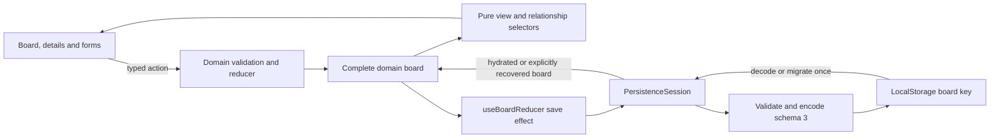

# TaskFlow v2 architecture and state ownership

This is the current architecture after #104–#116 and #44–#49, updated for the
v2.0.0 release preparation. Earlier implementation-stage plans are retained in
Git history; this guide describes the merged behavior.

## Boundaries and data flow

`App` composes board state, ordering preferences, storage feedback and confirmed
recovery. `Board` owns task selection/navigation, movement/deletion and operation
feedback. `AppShell` supplies page structure and toolbar/overlay slots; it does
not own domain actions. Component CSS owns local layout, while shared tokens and
controls own the common visual language. `useModalFocus` owns modal stacking,
background isolation, focus containment/restoration and Escape handling.

## State ownership

| State | Owner / lifetime |
| --- | --- |
| Tasks, stage membership, links, priorities/categories, timestamps, arrival arrays and optional manual positions | `useBoardReducer` + domain reducer; board schema 3 |
| Selected Priority/Manual mode | `useOrderingPreference`; independent preference schema 1 |
| Query and Category/Priority/Status filters | `useBoardViewPreferences`; reset on remount |
| Selected task/details/editor, mobile active stage, dialogs, drafts, drag state, focus targets and feedback | Board/form/toolbar/accessibility owners; temporary interaction state |
| Recovery classification, known raw snapshot/revision, notice and saved-reference guards | `PersistenceSession`; in memory, not serialized board fields |
| Visible tasks/counts, sorted projections, parent context, child progress and capacity | Pure selectors/configuration; derived from the complete board |

No external state library, backend, URL-backed filter state or speculative global
context is needed for this workload. State ownership is separated even when
related values share one component. See [preferences](v2-view-preferences.md).

## TypeScript and domain operations

`TaskStatus`, `Priority`, `TaskCategory` and action unions restrict supported
values. `TaskEdits` permits content fields while identity, status and relationships
remain intention-specific reducer operations. `Date` values belong to the domain;
DTOs serialize canonical strings. Imports use explicit type boundaries. Strict
TypeScript, unused-value checks and exhaustive discriminated-result handling
support the runtime guards; TypeScript does not validate stored JSON.

IDs and action timestamps are supplied before dispatch. UI preflight produces a
field or movement error, then the reducer repeats validation against its own
current complete snapshot. Accepted operations return one immutable next board;
rejections retain the original reference and timestamp. This protects against
stale edits and avoids intermediate partial changes.

Creation, content edits, status movement, reordering, parent assignment and
confirmed parent deletion are explicit actions. Parent deletion removes the
parent and detaches surviving children in one update. Assignment changes one
child-owned `parentId`; parent child-ID arrays/progress are not duplicate stored
sources. Self-links, cycles, deeper nesting and finishing a parent with unfinished
children are rejected. Children retain independent workflow stages.

Content validation shares form/domain rules without applying new form limits
retroactively to supported historical saved content. Identity checks cover tasks
and retained checklist entries. The detailed atomicity contracts remain in
[reducer/validation source](../src/domain/board/boardValidation.ts) and their tests.

## Selectors, workflow and ordering

`taskRelationships` provides unique task lookup, parent/children and completion
progress. `filterBoardColumns` produces a projection rather than editing source
arrays. `selectOrderedTasks` applies Priority or Manual order to visible IDs.
`boardPresentation` assembles card relationship context. #49 found these derived
calculations inexpensive at the approved workload tiers; no broad memoization or
second selector framework was introduced.

Stage movement is forward by one step. `boardCapacity` counts the full board,
including hidden records and children: In Progress=5, In Review=3, other stages
unlimited. Hydration accepts over-limit columns; incoming moves remain blocked,
while exits and valid same-column placements can recover the board.

Column `tasks` arrays preserve arrival ties. Optional domain `manualOrder` lists
contain every column task ID once; they never change task priorities or arrival
arrays. First explicit Manual selection initializes the full board from Priority
and requires a verified save before persisting the mode. Existing valid positions
survive mode switches. Filtered views preserve hidden positions and disable
same-stage reordering. Pointer/touch Manual placement can target a gap; keyboard
cross-stage movement uses the defined top placement. All input methods share
workflow, relationship, order and capacity validation.

## Persistence and recovery

`utils/storage.ts` parses unknown input, then schema/migration validators construct
an explicit trusted projection. `schema.ts` maps domain dates and optional order
into schema-3 DTOs; uninitialized order is stored as `null`. Unknown supported
fields are omitted from later serialization. Future schema versions are preserved
without interpreting their payload. Board and preference versions are independent.

`PersistenceSession` hydrates once per mount, exposes typed recovery states and
coordinates normal saves, explicit retry/read/repair/replacement and external-tab
warnings. Current valid hydration does not rewrite storage. Supported legacy
migration validates the whole converted board before writeback; repeated loads
do not duplicate children or regenerate manual positions. Schema-2-to-3 preserves
valid legacy content, links, dates, arrival order and optional manual positions.

A normal save verifies the expected raw snapshot, validates/projects the entire
candidate, serializes it with a revision, performs one board-key write, and
checks readback. Autosave runs after an accepted domain update; it is not a
transaction joining React state to LocalStorage. A failed write retains local
work with explicit feedback instead of rolling the reducer back.

Invalid/future/failed-migration sources remain untouched and paused; damaged order
restores safe core data in Priority until confirmed repair. Read restrictions,
write failures and conflicts have separate recovery actions. Replacement requires
confirmation; dismissing feedback does not clear the restriction. LocalStorage
has no atomic compare-and-swap, and a postflight failure can follow a complete
write. Other-tab data is neither silently adopted nor merged.

See the [schema contract](v2-persistence-schema.md), [migration guide](v2-data-migration.md)
and [recovery guide](v2-persistence-recovery.md) for exact result variants,
conversion rules and preservation limits. There is no automatic downgrade,
backup/export, server storage or cross-device synchronization.

## Evidence

The [testing risk map](v2-testing.md) links domain, integration, migration,
recovery, input and accessibility contracts to tests. The [#49 QA report](v2-performance-regression.md)
records 487 Vitest tests, 70 Chromium cases, selected Firefox/WebKit coverage,
representative workloads, bundle inspection and Lighthouse results. The release
checklist distinguishes these technical results from pending exact-origin staging
and production validation.
